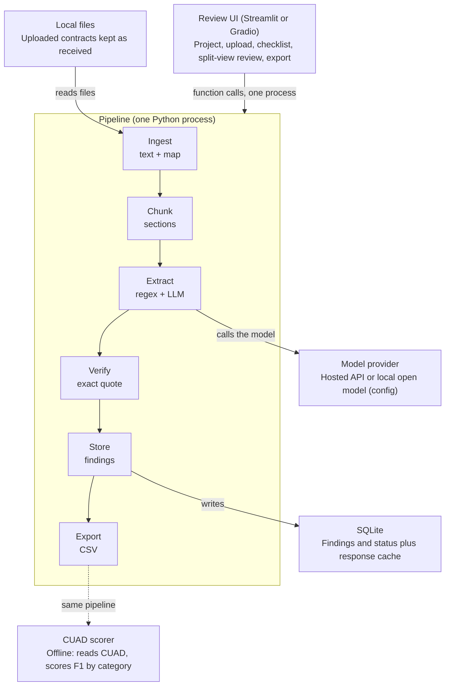
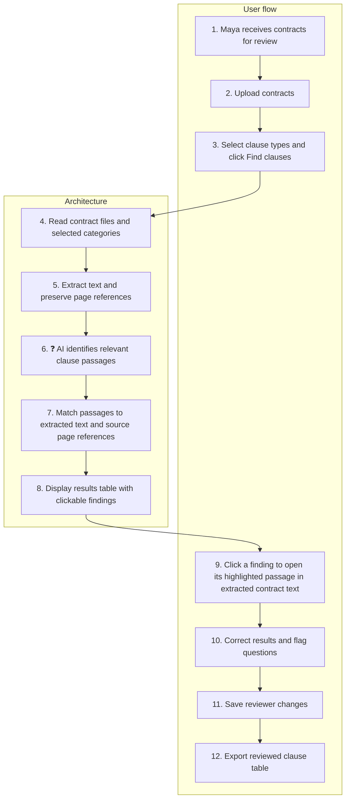

# Build Design Notes (early design from Nov 3)

This captures Kerrian's early design breakdown, including the architecture diagram, user flow and tables that existed only as screenshots. **The final PRD is the source of truth.** Where this disagrees with the PRD, the PRD wins (see the last section).

## Summary

A review tool where a junior lawyer uploads contracts, picks a clause checklist, and verifies extracted quotes against highlighted source text before exporting a table.

It keeps these principles:
- Every finding links to its source passage.
- A missing clause reads "not found, review required" and never "does not exist".
- The lawyer makes every judgment.

It cuts what a class build can't support: multi-user collaboration, OCR for scans, deadline reminders, and policy comparison.

## Who might use it

The best way to define the user is **someone who repeatedly finds, extracts and organizes contract terms for review.**

- **Junior lawyers:** review customer contracts during an acquisition. Benefit: less searching and copying, clearer evidence for senior review.
- **Paralegals and legal analysts:** prepare contract summaries and locate requested provisions. Benefit: consistent tables with traceable source text.
- **In-house legal counsel:** review incoming vendor or customer agreements. Benefit: faster access to relevant wording before making legal judgments.
- **Contract managers:** find renewal dates, notice periods and termination provisions across agreements. Benefit: easier organization of obligations and deadlines.
- **Procurement teams:** compare payment, renewal and service terms across supplier contracts. Benefit: faster comparison and clearer questions for legal review.
- **Legal operations teams:** organize existing contracts into a searchable repository. Benefit: less manual extraction and more consistent records.

**Where to start:** junior lawyers, paralegals and legal analysts, because the workflow matches closely. Contract managers may also need deadline tracking and reminders. Procurement teams may need comparison against company policies. Those are later audiences.

## Example user: Maya

*Maya is an illustrative persona, not a documented customer case. Her pain points are hypotheses to validate, not facts.*

Maya is a junior corporate legal associate at a law firm helping a client acquire a software company. A senior lawyer asks her to review **30 customer and supplier contracts** and prepare a table of important terms. The team needs to know which agreements might need attention before the acquisition closes, for example contracts with assignment restrictions or change-of-control provisions.

Maya can read and understand contracts. The repetitive work is finding the relevant wording, recording it accurately, and making the findings easy for someone else to verify.

### Her pain points

- **Different wording and headings.** Relevant language appears under "Miscellaneous" instead of an obvious clause heading. *How the build helps:* it finds candidate passages by meaning and shows the exact source text.
- **Repeated searches across documents.** She checks the same clause categories in every agreement. *How the build helps:* it applies the same checklist to every uploaded contract.
- **Manual copying and organizing.** She transfers quotations, document names and page references into a spreadsheet. *How the build helps:* it builds a structured clause table with source locations.
- **Uncertainty about missing results.** A keyword search returns nothing, but she still has to check the contract. *How the build helps:* it marks the category "not found, review required" and lets her inspect the source.
- **Senior-review back-and-forth.** The senior lawyer asks, "Where does the contract actually say that?" *How the build helps:* it links each finding directly to its supporting passage.

### Her day, step by step

At 9 a.m., Maya receives the contracts and the senior lawyer's review checklist. This is when she opens the product.

1. **Create a review.** She names the project "Software Company Acquisition." The product keeps the contracts and findings together.
2. **Upload contracts.** She adds the customer and supplier agreements. The product checks that the documents are readable and flags processing failures.
3. **Choose the checklist.** She selects assignment, change of control, termination for convenience, renewal and governing law. The product searches each contract for those categories.
4. **Inspect findings.** She opens the first contract's results. The product shows the extracted wording beside the contract passage and its location.
5. **Verify and correct.** She accepts correct passages, removes false matches and adds anything missed. The product records her changes and whether each category has been reviewed.
6. **Escalate questions.** She flags a provision she wants the senior lawyer to interpret. The product attaches her question to the exact passage.
7. **Export and share.** She downloads the reviewed table for the deal team. It includes contract names, clause categories, quotations, locations and unresolved questions.

**Example:** the product finds a passage saying assignment requires written consent. Maya verifies the wording and flags it for the senior lawyer. The lawyer decides what it means for the deal.

**The value:** Maya spends less time searching, copying and assembling evidence, so she can spend more time on what the terms mean. Success depends on whether the time saved is greater than the effort of checking the tool's results.

## User flow (8 steps)

1. **Create review.** The user names the project. The system creates a project record. *Minimal.*
2. **Upload.** The user drops in the contracts. The system extracts text, checks readability and flags files that fail. *Text and PDF.*
3. **Checklist.** The user selects the categories. The system queues one job per contract and category.
4. **Wait.** The user can start reading a contract by hand while jobs run. The system runs in the background and updates status as each contract finishes.
5. **Inspect.** The user opens a contract in a split view. The system shows each extracted quote beside the highlighted source passage. *This is the core demo.*
6. **Verify.** The user accepts, rejects or adds a missed passage, in the same view. The system saves a review status per finding and per category. *Accept and reject: yes. Manual add: stretch.*
7. **Escalate.** The user flags a passage with a question for the senior lawyer. The system attaches a note to that passage. *One note field only.*
8. **Export.** The user downloads the reviewed table. The system writes contract, category, quote, location, status and note to a file. *CSV first.*

### The three category states

- **Found:** one or more quotes passed verification and wait for review.
- **Not found, review required:** no verified quote. The tool never claims the clause is absent. The reviewer must check the contract.
- **Failed to process:** the file was unreadable or a job errored. It is listed and never silently dropped.

## Architecture

Everything runs in one Python process. The review screen calls the pipeline, and the same pipeline feeds the CUAD scorer.

The Verify stage drops any quote not found in the source.

Three things sit outside the pipeline: the uploaded files, SQLite, and the model provider. The CUAD scorer runs the same code offline and is not part of the review screen.

### Numbered sketch (Nov 3)

This is the user flow and the architecture on one chart, numbered in the order things happen. Steps 1–3 and 9–12 are the user's actions. Steps 4–8 are the system working. Step 6 is marked as the part we are least sure will work.

**Least sure (step 6):** can the AI find clauses when the wording varies or the relevant information is spread across several sections? **How we test it:** compare the extracted passages with CUAD labels and measure missed clauses and false matches. A "not found" result still needs human review.

**Note:** this sketch has the user clicking a finding to see it highlighted in the extracted text. The final PRD makes that highlighting a P1 item. The P0 version shows the quote and its page.

### Pipeline stages

1. **Ingest**
   - Input: uploaded text or PDF file
   - Output: document text plus a map from character offset to page and section
   - If it fails: empty, scanned or unreadable file gets status "Failed to process", with the reason logged
2. **Chunk**
   - Input: document text
   - Output: chunks with start and end offsets, split on section headings
   - If it fails: if no headings are found, use overlapping fixed-size windows
3. **Extract**
   - Input: one chunk and one category definition
   - Output: candidate quotes or "none", from a regex pass and a model call
   - If it fails: on a model error or malformed reply, retry once, then mark the job failed
4. **Verify**
   - Input: a candidate quote and the document text
   - Output: exact start and end offsets, if the quote appears in the source after whitespace normalization
   - If it fails: the quote is dropped and logged
5. **Store**
   - Input: verified findings
   - Output: findings and a category status per contract
   - If it fails: overlapping duplicates are merged
6. **Export**
   - Input: findings and review states
   - Output: CSV with contract, category, quote, location, status and note
   - If it fails: none expected

The fourth stage protects the reviewer: no quote reaches the screen unless it appears word for word in the source.

## Data model (five SQLite tables)

- **Project:** id, name. Groups one review's contracts and findings.
- **Document:** id, project, filename, text, page map, status, failure reason. One uploaded contract and its processing state.
- **Finding:** id, document, category, quote, start, end, page, source (auto or manual), review (pending, accepted, rejected), note. One extracted or added passage and the reviewer's decision on it.
- **CategoryStatus:** document, category, state (found, not found, failed), reviewed flag. Drives the three visible states and review progress.
- **LLMCache:** key (hash of model, prompt and chunk text), response. Makes re-runs and demos free.

## Design decisions

Each choice trades something away on purpose.

- **Verify every quote against the source.** Models paraphrase. A quote that isn't in the text can't be highlighted, so it is dropped and logged.
- **Favor recall over precision.** A false match costs the reviewer one click. A missed clause costs them the deal review. Tune prompts to over-find, and let verification and the reviewer filter.
- **Cache every model response.** Key it by model, prompt and chunk text so re-runs cost nothing.
- **Keep the model behind one interface.** A config switch picks a hosted API (key in an environment variable) or a local open model. The second also gives the write-up a comparison.
- **Run the scorer outside the UI.** The same pipeline reads CUAD contracts and scores overlap per category.

## Data handling

Real deal contracts should not go to a hosted model. Demos and evaluation use public contracts (CUAD), and the write-up says so.

## Scope

- **In scope:** 3–5 categories mapped to CUAD labels, text and PDF upload, background extraction, a split view with accept and reject, one note per finding, CSV export, and the scorer.
- **Stretch:** adding a missed passage by hand, a formatted Excel export, and a local-model comparison.
- **Cut:** login and multiple users, comment threads, OCR for scanned files, deadline reminders, policy comparison, and the contract manager, procurement and legal operations users.

## Evaluation and test plan

- **Accuracy:** run 50–100 CUAD contracts and report precision, recall and F1 per category. Fix the span-overlap threshold and document it before the first run.
- **Baseline:** a regex pass using phrases such as "governed by the laws of". It shows whether the model adds value and works without an API key.
- **Ceiling:** annotators disagree on clause boundaries, and rare categories give noisy scores. Report sample sizes and say so.
- **Usability mini-test:** 2–3 people review the same 5 contracts with and without the tool. Record time and missed clauses. This is the closest honest test of whether time saved exceeds checking effort.
- **Known failure cases to document:**
  - Clauses split across chunks
  - Text in exhibits or amendments
  - Defined terms and cross-references
  - PDF extraction errors

## Risks and open questions

- **Model cost and rate limits:** test on a few contracts first and rely on the response cache.
- **Long contracts:** chunk by section from day one, because chunking affects both accuracy and cost.
- **Unvalidated persona:** the pain points are hypotheses and have not been checked with real reviewers.
- **Open:** hosted API or local open model for the main results, and does the course provide API credits?
- **Open:** which exact CUAD label names map to the five categories?

## Where this differs from the final PRD

The PRD wins on all of these.

- **Timeline:** this assumes two weeks. The PRD has a three-day build window (Nov 5–7).
- **Location in the contract:** this uses section and character offsets. The PRD uses page numbers only and does not detect section headings.
- **Chunking:** this splits on section headings. The PRD uses about 3,000-character windows with 300 characters of overlap.
- **Evaluation set:** this suggests 50–100 CUAD contracts. The PRD uses all 102 contracts in CUAD's test split.
- **Model:** this leaves hosted vs. local open. The PRD uses Claude Sonnet, with a local model only as a stretch.
- **Split view and highlighting:** this treats the split view as core. The PRD makes highlighting P1 and shows quote plus page.
- **Open questions:** both answered in the PRD. The model is Claude Sonnet with a $40 limit, and the CUAD labels are Anti-Assignment, Change Of Control, Termination For Convenience, Renewal Term and Governing Law.
